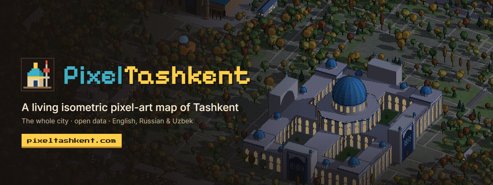

<div align="center">
  
</div>

<div align="center">

[](https://www.khronos.org/webgl/)
[](https://threejs.org/)
[](https://www.python.org/)
[](https://www.openstreetmap.org/copyright)
[](LICENSE)

</div>

# iso-tash — Tashkent Pixel Map

**Live: [pixeltashkent.com](https://pixeltashkent.com)**

A living isometric pixel-art map of Tashkent, Uzbekistan. Explore the city as a real-time **WebGL 2** scene powered by **three.js**, with a custom shader that adds pixel-art colours, dithering and depth outlines.

Buildings, roads, parks, waterways and trees are derived from OpenStreetMap and delivered as pre-baked city tiles. The map runs locally in your browser; an internet connection is only needed for external photos, fonts and map links.

## Features

- **A city at full scale.** Around 390,000 buildings, millions of trees, detailed roads, canals, parks, railways and sports grounds.
- **Landmarks you can explore.** 28 hand-built landmark models sit on their real map footprints, including the TV Tower, Chorsu Bazaar, Hazrati Imam, NestOne, Hilton Tashkent City, Humo Arena and more. Select a landmark to fly to it and open a card with facts, links and an attributed photo.
- **A working transport network.** Cars follow the road graph, react to roughly 2,000 mapped traffic lights and handle turns and junctions. Buses and marshrutkas serve major roads; metro and railway infrastructure is represented across the city.
- **Real streets and terrain.** Bridges, flyovers and tunnels follow their mapped routes. The scene includes elevated metro sections, pedestrian crossings, canals and terrain shaped by elevation data.
- **A city that feels alive.** Windows and street lamps light up at night, trees change with the season, traffic thins after dark, and selected landmarks have custom night lighting and moving details.
- **Easy exploration.** Use the minimap, location panel, guided tour and day/night or quality controls to move around the city.

## Performance

The renderer uses multiple levels of detail (LOD) to keep a city-sized scene responsive:

| View | Rendering |
|---|---|
| Close | Detailed geometry and real-time shadows |
| Mid | Simplified tree crowns; shadows are reduced |
| Far | Pre-rendered tile textures for ground, roads, water and low vegetation; tall buildings and landmarks remain 3D |

Tiles are loaded only when visible. Web Workers decode tile data and build geometry; OffscreenCanvas rasterises far-view textures. Instancing, merged meshes, frustum culling and quality presets help reduce GPU and CPU work.

At far zoom, the project reports reducing the scene from roughly 15.5 million to 0.3 million triangles per frame (about 40× fewer), measured at 1600×900 on the highest preset.

## Getting started

1. Clone or download the repository.
2. Open `index.html` in a WebGL 2-capable browser.
3. Or run `start-server.bat` to start a local static server (requires Python 3).

Recent versions of Chrome, Edge, Firefox or Safari are recommended. The map itself works from local files; external photos, fonts and Google Maps links require internet access.

## Controls

| Action | Mouse / touch | Keyboard |
|---|---|---|
| Pan | Drag | WASD / arrow keys |
| Zoom | Wheel / pinch, double-click | `+` / `−` |
| Rotate 90° | On-screen buttons | `Q` / `E` |
| Open a landmark | Click its model, label or list item | — |
| Close panels | — | `Esc` |

## Project structure

```
index.html, css/style.css   app entry point and styles
js/scene.js                 camera, lighting and pixel-art shader
js/geo-worker.js            tile decoding and far-LOD textures
js/tiles.js                 tile loading, LOD and rendering
js/models*.js               landmark, stadium and tower models
js/traffic.js                road graph, vehicles and traffic lights
js/city.js, js/ui.js         scene loop, city state and interface
lib/                         three.js r149, earcut 2.2.4
data/                        pre-baked city tiles and map metadata
tools/bake/                  Python data preparation scripts
```

## Updating map data

The city data is baked from OpenStreetMap, vector tiles and elevation sources. The scripts in `tools/bake/` fetch source data, build the tile dataset and apply specialised passes for roads, greenery, pitches, crossings and terrain. Landmark placement is maintained in `tools/bake/landmarks_spec.json`; default building and roof colours are in `tools/bake/palette.py`.

## Limitations

- Ordinary buildings are generated from OSM footprints and tags; heights may be estimated where source data is missing.
- New Tashkent is still sparsely mapped in OpenStreetMap.
- Opening hours and prices shown on information cards may become outdated.

## Credits and licences

The original iso-tash application source code is licensed under the [MIT License](LICENSE). This does not change the licences of third-party software or source data.

- Map data © [OpenStreetMap contributors](https://www.openstreetmap.org/copyright), licensed under ODbL 1.0. OSM-derived datasets remain under ODbL.
- Vector tiles: [OpenFreeMap](https://openfreemap.org) (OpenMapTiles schema); buildings, trees, traffic lights and boundaries are sourced through the Overpass API (maps.mail.ru mirror).
- Elevation: [Terrain Tiles](https://registry.opendata.aws/terrain-tiles/) from the AWS Open Data Registry. Tashkent-area data includes SRTM (NASA/USGS); lower zooms also use GMTED2010 (USGS) and ETOPO1 (NOAA). See [Tilezen attribution](https://github.com/tilezen/joerd/blob/master/docs/attribution.md).
- [three.js](https://threejs.org) is MIT-licensed; [earcut](https://github.com/mapbox/earcut) is ISC-licensed. Their notices remain applicable.
- Landmark reference and card photos: Wikimedia Commons and Wikipedia; photo authors and licences are shown with the images.
- Fonts: Inter, Pixelify Sans and Press Start 2P (SIL Open Font License).
- Visual reference: [Isometric Warsaw](https://bedirhanyildirim.com/warsaw-izo/) by Bedirhan Yıldırım.
